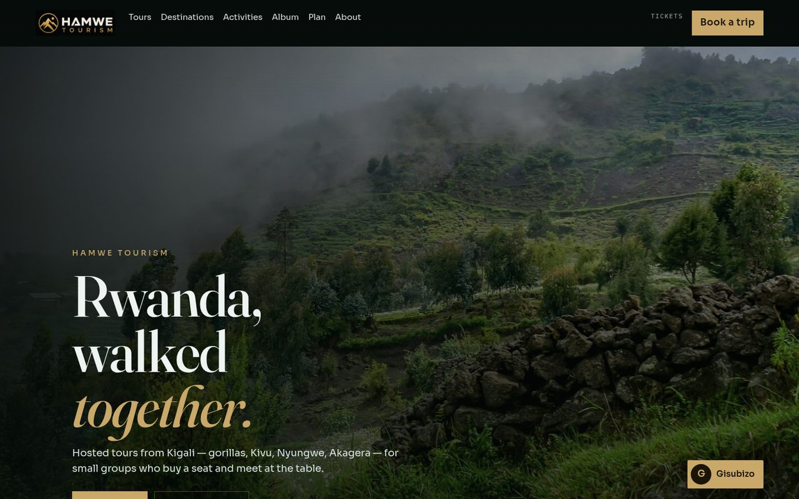

# Hamwe Tourism

Storefront for Hamwe Tourism, a Kigali travel house. Hosted Rwanda tours, day tickets, and a desk that answers in English.

**Live:** [https://arnold-rg.github.io/hamwe/](https://arnold-rg.github.io/hamwe/)

[](https://arnold-rg.github.io/hamwe/)

## Develop locally

```bash
git clone https://github.com/Arnold-RG/hamwe.git
cd hamwe
npm install
npm run dev
```

The dev server uses the same `/hamwe/` base as production, so open [http://localhost:5173/hamwe/](http://localhost:5173/hamwe/).

## Build

```bash
npm run build
npm test
```

`npm run build` type-checks, bundles with Vite, writes a `404.html` SPA fallback, copies `SECURITY.md` into `dist/`, and runs the published-file privacy check.

On every push to `main`, GitHub Actions deploys `dist/` to GitHub Pages at `/hamwe/`.

## License

MIT. See [LICENSE](LICENSE).
